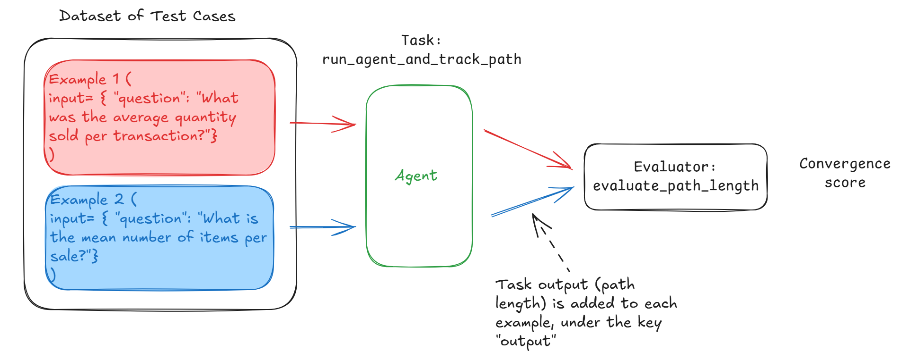

# Lab 4: Adding Trajectory Evaluations

In this lab, you will compute the convergence score of the agent, and you will use Phoenix experiments to set up this evaluation. The video goes through the components of an experiment (dataset consisting of examples, task, evaluator).

Here's how you will define the experiment components in this lab to compute the convergence score:



You will create a dataset of Phoenix examples where each example contains a different version of the same question. You will then create the task `run_agent_and_track_path` that you will use to run on each example and compute the path length. Finally, you will create the evaluator `evaluate_path_length` that computes the convergence score.

## Importing necessary libraries

```python
import warnings
warnings.filterwarnings('ignore')
```

```python
import phoenix as px
from phoenix.evals import OpenAIModel
from phoenix.experiments import run_experiment, evaluate_experiment
from phoenix.experiments.types import Example
from phoenix.experiments.evaluators import create_evaluator
from phoenix.otel import register
import pandas as pd
from datetime import datetime
import os
import nest_asyncio
nest_asyncio.apply()
```

```python
from utils import run_agent, get_phoenix_endpoint
```

<p style="background-color:#fff6ff; padding:15px; border-width:3px; border-color:#efe6ef; border-style:solid; border-radius:6px"> 💻 &nbsp; <b>Access <code>requirements.txt</code>, <code>utils.py</code> and <code>helper.py</code> files:</b> 1) click on the <em>"File"</em> option on the top menu of the notebook and then 2) click on <em>"Open"</em>. For more help, please see the <em>"Appendix – Tips, Help, and Download"</em> Lesson.</p>

<p style="background-color:#f7fff8; padding:15px; border-width:3px; border-color:#e0f0e0; border-style:solid; border-radius:6px"> 🚨
&nbsp; <b>Different Run Results:</b> The output generated by AI chat models can vary with each execution due to their dynamic, probabilistic nature. Your results might differ from those shown in the video.</p>

## Creating the Dataset of Test Cases

```python
px_client = px.Client()
```

```python
convergence_questions = [
    "What was the average quantity sold per transaction?",
    "What is the mean number of items per sale?",
    "Calculate the typical quantity per transaction",
    "What's the mean transaction size in terms of quantity?",
    "On average, how many items were purchased per transaction?",
    "What is the average basket size per sale?",
    "Calculate the mean number of products per purchase",
    "What's the typical number of units per order?",
    "What is the average number of products bought per purchase?",
    "Tell me the mean quantity of items in a typical transaction",
    "How many items does a customer buy on average per transaction?",
    "What's the usual number of units in each sale?",
    "What is the typical amount of products per transaction?",
    "Show the mean number of items customers purchase per visit",
    "What's the average quantity of units per shopping trip?",
    "How many products do customers typically buy in one transaction?",
    "What is the standard basket size in terms of quantity?"
]

convergence_df = pd.DataFrame({
    'question': convergence_questions
})

now = datetime.now().strftime("%Y-%m-%d %H:%M:%S")
dataset = px_client.upload_dataset(dataframe=convergence_df,
                                   dataset_name=f"convergence_questions-{now}",
                                   input_keys=["question"])
```

### Link to Phoenix UI

You can open this link to check out the Phoenix UI and the uploaded dataset. You can use the same link to check out the results of the experiment you'll run in this notebook.

**Note**:
- Since each notebook of this course runs in an isolated environment, each notebook links to a different Phoenix server. This is why you won't see the projects you've worked on in the previous notebooks.
- Make sure that the notebook's kernel is running when checking the Phoenix UI. If the link does not open, it might be because the notebook has been open or inactive for a long time. In that case, make sure to refresh the browser, run all previous cells and then check this link.

```python
print(get_phoenix_endpoint())
```

## Creating the Task

```python
# helper method to format the output returned by the task
def format_message_steps(messages):
    """
    Convert a list of message objects into a readable format that shows the steps taken.

    Args:
        messages (list): A list of message objects containing role, content, tool calls, etc.

    Returns:
        str: A readable string showing the steps taken.
    """
    steps = []
    for message in messages:
        role = message.get("role")
        if role == "user":
            steps.append(f"User: {message.get('content')}")
        elif role == "system":
            steps.append("System: Provided context")
        elif role == "assistant":
            if message.get("tool_calls"):
                for tool_call in message["tool_calls"]:
                    tool_name = tool_call["function"]["name"]
                    steps.append(f"Assistant: Called tool '{tool_name}'")
            else:
                steps.append(f"Assistant: {message.get('content')}")
        elif role == "tool":
            steps.append(f"Tool response: {message.get('content')}")

    return "\n".join(steps)
```

```python
def run_agent_and_track_path(example: Example) -> str:
    messages = [{"role": "user", "content": example.input.get("question")}]
    ret = run_agent(messages)
    return {"path_length": len(ret), "messages": format_message_steps(ret)}
```

## Running the Experiment

```python
experiment = run_experiment(dataset,
                            run_agent_and_track_path,
                            experiment_name="Convergence Eval",
                            experiment_description="Evaluating the convergence of the agent")
```

```python
experiment.as_dataframe()
```

## Evaluating the Path

```python
outputs = experiment.as_dataframe()["output"].to_dict().values()

# Will include the user and system messages
optimal_path_length = min(output.get('path_length') for output in outputs if output and output.get('path_length') is not None)
print(f"The optimal path length is {optimal_path_length}")
```

```python
@create_evaluator(name="Convergence Eval", kind="CODE")
def evaluate_path_length(output: str) -> float:
    if output and output.get("path_length"):
        return optimal_path_length/float(output.get("path_length"))
    else:
        return 0
```

```python
experiment = evaluate_experiment(experiment,
                            evaluators=[evaluate_path_length])
```

<div style="background-color:#fff6ff; padding:13px; border-width:3px; border-color:#efe6ef; border-style:solid; border-radius:6px">

<p> ⬇ &nbsp; <b>Download Notebooks:</b> 1) click on the <em>"File"</em> option on the top menu of the notebook and then 2) click on <em>"Download as"</em> and select <em>"Notebook (.ipynb)"</em>.</p>

<p> 📒 &nbsp; For more help, please see the <em>"Appendix – Tips, Help, and Download"</em> Lesson.</p>

</div>
