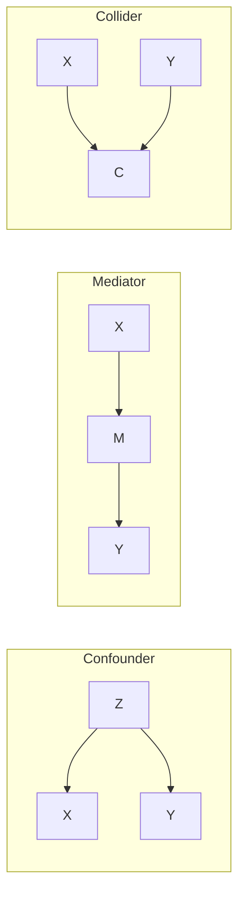

# 4 — Correlation, Confounding and Causation

Larkspur's marketing team has good news: customers who opted in to the loyalty email placed 1.21 more orders this year than those who did not. The email costs almost nothing, so they propose emailing everybody by default. That number is real and it is close to useless, because the people who opt in are the people who were already keen. In the simulation in [4b](04b-potential-outcomes-and-quasi-experiments.md), the true effect is 0.30. A/B tests dodge this problem by construction, but plenty of questions come to you after the fact, or concern things you cannot randomise. This chapter is about reading observational data without fooling yourself: what a correlation does and doesn't say, how a third variable can create or reverse one, and, for the next chapter, the designs that recover a causal answer when randomisation is off the table.

## Measuring association

Start with the description. These coefficients all measure how strongly two variables move together, for different kinds of data.

| Coefficient | Measures | Sensitive to outliers | Use when |
|---|---|---|---|
| Pearson r | linear association | very | both variables roughly Normal, relationship linear |
| Spearman ρ | monotonic association (Pearson on ranks) | no | ordinal data, skew, outliers, curved but monotonic |
| Kendall τ | concordant vs discordant pairs | no | small samples, many ties |
| Point-biserial | one binary, one continuous | yes | equivalent to a t-test |
| Cramér's V | two categorical | no | derived from [chi-square](../../02-probability-and-statistics/notes/05-hypothesis-testing.md) |

One point can wreck Pearson, a demonstration taken from the [statistics practice notebook](../../02-probability-and-statistics/practice/5-statistical-analysis.md):

```python
import numpy as np
import pandas as pd
from scipy import stats
from scipy.optimize import minimize
import statsmodels.formula.api as smf

rng = np.random.default_rng(304)
x = np.linspace(1, 10, 30)
y_clean = x + rng.normal(0, 0.5, 30)
y_out = y_clean.copy()
y_out[-1] = 50
print(f"clean:        Pearson {stats.pearsonr(x, y_clean)[0]:.3f}  Spearman {stats.spearmanr(x, y_clean)[0]:.3f}")
print(f"one outlier:  Pearson {stats.pearsonr(x, y_out)[0]:.3f}  Spearman {stats.spearmanr(x, y_out)[0]:.3f}")
```

```text
clean:        Pearson 0.985  Spearman 0.983
one outlier:  Pearson 0.583  Spearman 0.983
```

Spearman barely notices, because the outlier was already the largest rank. And no single coefficient describes a relationship's shape, which is the point of [Anscombe's 1973 paper](https://doi.org/10.1080/00031305.1973.10478966). His four small datasets share almost the same summary statistics:

```python
x123 = [10, 8, 13, 9, 11, 14, 6, 4, 12, 7, 5]
quartet = {
    "I": (x123, [8.04, 6.95, 7.58, 8.81, 8.33, 9.96, 7.24, 4.26, 10.84, 4.82, 5.68]),
    "II": (x123, [9.14, 8.14, 8.74, 8.77, 9.26, 8.10, 6.13, 3.10, 9.13, 7.26, 4.74]),
    "III": (x123, [7.46, 6.77, 12.74, 7.11, 7.81, 8.84, 6.08, 5.39, 8.15, 6.42, 5.73]),
    "IV": ([8, 8, 8, 8, 8, 8, 8, 19, 8, 8, 8], [6.58, 5.76, 7.71, 8.84, 8.47, 7.04, 5.25, 12.50, 5.56, 7.91, 6.89]),
}
for name, (a, b) in quartet.items():
    fit = stats.linregress(a, b)
    print(f"{name:<3} mean y {np.mean(b):.2f}  r {fit.rvalue:.3f}  line y = {fit.intercept:.2f} + {fit.slope:.3f} x")
```

```text
I   mean y 7.50  r 0.816  line y = 3.00 + 0.500 x
II  mean y 7.50  r 0.816  line y = 3.00 + 0.500 x
III mean y 7.50  r 0.816  line y = 3.00 + 0.500 x
IV  mean y 7.50  r 0.817  line y = 3.00 + 0.500 x
```

Plotted, they are a noisy line, a clean curve, a straight line with one outlier, and a vertical stack with one far-off point that creates the whole correlation. So plot before you correlate. `sns.heatmap(df.corr(), annot=True, center=0)` is the quickest overview of a feature table, and [chapter 1 of the statistics pillar](../../02-probability-and-statistics/notes/01-descriptive-statistics-and-eda.md) shows how to read one, but treat a heatmap as a list of things to investigate.

*Think Stats* gives the same warnings in textbook form (ch. 9). Pearson's ρ measures linear association only: a clear curve can give ρ = 0, and ρ says nothing about slope, since a flat-looking and a steep line can share ρ = 1. It is not robust to outliers, which Anscombe's quartet shows, and the remedies are Spearman's rank correlation or a transform such as the log of lognormal data. For evidence of cause Downey lists time order, randomisation (an RCT is "the most reliable" way), natural experiments, and holding a confounder fixed by stratifying. His worked case compares NSFG birth weight of first babies and others within groups of mother's age, because age relates to both birth order and weight. The sections below turn each of these into estimators.

## Confounding

A confounder Z causes both X and Y, so X and Y correlate even when neither touches the other.

```text
      temperature
       /       \
      v         v
 ice cream    drownings
```

```python
rng = np.random.default_rng(1)
temperature = rng.normal(20, 8, 365)
ice_cream = 100 + 3 * temperature + rng.normal(0, 10, 365)
drownings = 2 + 0.1 * temperature + rng.normal(0, 1, 365)
print(f"r(ice cream, drownings) = {stats.pearsonr(ice_cream, drownings)[0]:.3f}, p = {stats.pearsonr(ice_cream, drownings)[1]:.1e}")
```

```text
r(ice cream, drownings) = 0.517, p = 2.2e-26
```

The correlation is strong and highly significant, and it is meaningless as a statement about ice cream.

### Partial correlation and regression

To control for Z, regress it out of both variables and correlate what is left. A regression with Z included does the same thing in one step, because the coefficient on X in `y ~ x + z` is the association holding Z fixed:

```python
def residuals(y, z):
    fit = stats.linregress(z, y)
    return y - (fit.slope * z + fit.intercept)

r, p = stats.pearsonr(residuals(ice_cream, temperature), residuals(drownings, temperature))
print(f"partial r given temperature = {r:.3f}, p = {p:.2f}")
days = pd.DataFrame({"drownings": drownings, "ice_cream": ice_cream, "temperature": temperature})
print("regression, no control:  ", round(smf.ols("drownings ~ ice_cream", days).fit().params["ice_cream"], 4))
print("regression, with control:", round(smf.ols("drownings ~ ice_cream + temperature", days).fit().params["ice_cream"], 4))
```

```text
partial r given temperature = 0.027, p = 0.61
regression, no control:   0.0269
regression, with control: 0.0026
```

Once temperature is held fixed, the link vanishes. Both methods remove only confounders you measured. An unmeasured confounder is untouched, which is why randomisation is the gold standard: it breaks the arrow from every confounder into treatment, measured or not.

### Bad controls

"Control for everything" sounds cautious, and it is wrong. Whether a variable belongs in the model depends on the causal story, which is why you draw the graph first. [Hernán and Robins (*What If*, §7.4)](https://miguelhernan.org/whatifbook) show why association cannot decide it: the traditional test for a confounder, built on associations with treatment and outcome, "misleads investigators into adjusting for variables when adjustment is harmful". [Pearl's survey](https://doi.org/10.1214/09-ss057) gives the formal rules for reading a graph to choose controls, and the [section below](#the-backdoor-and-front-door-criteria) states the two you will use most.



| Variable type | Path | Control for it? |
|---|---|---|
| Confounder | Z → X, Z → Y | yes |
| Mediator | X → M → Y | no, if you want the total effect of X |
| Collider | X → C ← Y | **no**: conditioning on it creates a spurious X–Y link |

A collider produces a correlation out of nothing. Take a selective programme that admits people on the sum of two independent scores:

```python
rng = np.random.default_rng(2)
test = rng.normal(0, 1, 20_000)
interview = rng.normal(0, 1, 20_000)                # independent by construction
admitted = test + interview > 1.5
print(f"everyone:  r = {np.corrcoef(test, interview)[0, 1]:+.3f}")
print(f"admitted:  r = {np.corrcoef(test[admitted], interview[admitted])[0, 1]:+.3f}  ({admitted.mean():.0%} of applicants)")
```

```text
everyone:  r = -0.013
admitted:  r = -0.682  (15% of applicants)
```

Among those admitted, a strong interview implies a weaker test, because you needed one or the other to get in. Any analysis limited to survivors of a filter has this risk: reviewers of purchased products, users who finished onboarding, customers still active.

A mediator gives a different error. Controlling for it removes the part of the effect you came to measure:

```python
rng = np.random.default_rng(3)
n = 50_000
coupon = rng.integers(0, 2, n)                      # randomised
visits = 1 + 0.8 * coupon + rng.normal(0, 1, n)     # the coupon brings people back
spend = 2 * visits + 0.3 * coupon + rng.normal(0, 3, n)
m = pd.DataFrame({"coupon": coupon, "visits": visits, "spend": spend})
print("total effect, y ~ coupon:             ", round(smf.ols("spend ~ coupon", m).fit().params["coupon"], 3), "(true 1.9)")
print("controlling for the mediator, visits: ", round(smf.ols("spend ~ coupon + visits", m).fit().params["coupon"], 3), "(direct only)")
```

```text
total effect, y ~ coupon:              1.921 (true 1.9)
controlling for the mediator, visits:  0.331 (direct only)
```

The coupon works mainly by bringing people back, and the model that holds visits fixed reports only the small direct part. Anything measured after treatment deserves suspicion as a control, for this reason and because it may also be a collider.

### The backdoor and front-door criteria

The table above gives three cases. The **backdoor criterion** is the rule that covers any graph. This section follows Pearl, Glymour and Jewell's [*Causal Inference in Statistics: A Primer*](https://web.cs.ucla.edu/~kaoru/primer-complete-2019.pdf) (Wiley, 2016). We read sections 3.3 and 3.4 and part of 3.6, not the whole book, and the page numbers are the printed ones. A backdoor path is any path between X and Y that starts with an arrow into X. Definition 3.3.1 (p. 61):

> Given an ordered pair of variables (X, Y) in a directed acyclic graph G, a set of variables Z satisfies the backdoor criterion relative to (X, Y) if no node in Z is a descendant of X, and Z blocks every path between X and Y that contains an arrow into X.

The primer gives the logic in three steps: block all the spurious paths, leave the directed paths from X to Y unperturbed, and create no new spurious paths. If Z passes, the effect comes from observational data alone:

P(Y = y | do(X = x)) = Σ_z P(Y = y | X = x, Z = z) P(Z = z)

Here do(X = x) means setting X, rather than observing it. Three consequences matter in practice:

- **Only a sufficient set is required.** An unmeasured variable need not end the analysis if another measured variable blocks its path (Figure 3.6, p. 62).
- **The set is not simply "all confounders".** A collider sometimes has to be adjusted, along with whatever blocks the path that adjustment opens (Figure 3.7, p. 63).
- **Any valid set gives the same answer** (p. 64). When two defensible sets disagree in a real analysis, at least one of them is wrong or the estimator is struggling.

The propensity score does not relax any of this. Inverse probability weighting is valid only when the covariates in the weight satisfy the criterion, and otherwise it may add bias (§3.6, p. 75). Weighting without the graph is still an assumption.

Sometimes the confounder can't be measured and no set will work. The **front-door criterion** can still identify the effect if a mediator carries it. A set Z satisfies the criterion relative to (X, Y) under three conditions (Definition 3.4.1, p. 69):

1. Z intercepts all directed paths from X to Y.
2. There is no backdoor path from X to Z.
3. All backdoor paths from Z to Y are blocked by X.

The idea is to chain two effects that can each be estimated: X on Z, which has no open backdoor, and Z on Y, whose backdoor is blocked by adjusting for X. The formula is P(y | do(x)) = Σ_z P(z | x) Σ_x' P(y | x', z) P(x'), given P(x, z) > 0 (Theorem 3.4.1). The primer's example is smoking, tar and cancer, using hypothetical data (pp. 66-69). In a linear model with a binary treatment, the chain reduces to a product of two slopes:

```python
rng = np.random.default_rng(406)
n_fd = 50_000
hidden = rng.normal(0, 1, n_fd)                                # never logged
treat = (rng.random(n_fd) < 1 / (1 + np.exp(-hidden))).astype(int)
middle = 0.5 * treat + rng.normal(0, 1, n_fd)                  # all of treat's effect runs through here
outcome = 0.8 * middle + 1.5 * hidden + rng.normal(0, 1, n_fd)  # true effect of treat: 0.5 * 0.8 = 0.40
f = pd.DataFrame({"treat": treat, "middle": middle, "outcome": outcome})
step1 = smf.ols("middle ~ treat", f).fit().params["treat"]
step2 = smf.ols("outcome ~ middle + treat", f).fit().params["middle"]
print(f"naive difference {f.outcome[f.treat == 1].mean() - f.outcome[f.treat == 0].mean():.3f}")
print(f"front-door: {step1:.3f} x {step2:.3f} = {step1 * step2:.3f} (true 0.40)")
```

```text
naive difference 1.649
front-door: 0.498 x 0.794 = 0.396 (true 0.40)
```

It works here because we wrote the graph to fit. In practice the conditions are rarely believable: the hidden cause must have no direct link to the mediator, and the mediator must carry all of the effect. It is rarer in analytics than the backdoor criterion, which every chapter on observational data relies on. [Chapter 5](05-matching-and-weighting.md) applies the backdoor rule to a real-shaped table, and shows what happens when an unlogged trait leaves the rule unmet.

## Simpson's paradox

Simpson's paradox is when a trend in aggregated data reverses within every subgroup. Here is the notebook's synthetic table:

| | Control | Treatment |
|---|---|---|
| Mild | 90 / 100 = 90.0% | 39 / 40 = 97.5% |
| Severe | 30 / 100 = 30.0% | 80 / 160 = 50.0% |
| **Overall** | 120 / 200 = **60.0%** | 119 / 200 = **59.5%** |

```python
trial = pd.DataFrame({
    "severity": ["mild", "mild", "severe", "severe"], "arm": ["control", "treatment"] * 2,
    "recovered": [90, 39, 30, 80], "patients": [100, 40, 100, 160],
})
rate = trial.pivot(index="severity", columns="arm", values="recovered") / trial.pivot(index="severity", columns="arm", values="patients")
print(rate.round(3))
total = trial.groupby("arm")[["recovered", "patients"]].sum()
print((total.recovered / total.patients).round(3).to_dict())
```

```text
arm       control  treatment
severity
mild          0.9      0.975
severe        0.3      0.500
{'control': 0.6, 'treatment': 0.595}
```

Treatment is better for mild patients and for severe patients, and worse overall, because treatment went mostly to severe cases. Arithmetic can't say which table to trust; only the causal story can. Severity affects both who was treated and who recovered, so it is a confounder and you stratify. If the subgroup had been something the treatment changed, the pooled table would be the right one. That was the deeplink case in [the metrics chapter](02-metrics-and-kpi-design.md).

The classic real case is graduate admissions at Berkeley in 1973. Women were admitted less often overall, but when [Bickel, Hammel and O'Connell (Science, 1975)](https://doi.org/10.1126/science.187.4175.398) looked department by department they found little sign of bias against women, because women had applied more often to departments that were harder to get into. Reinhart's account of the same case gives the margins: of 12,763 applications, 44% of men and 35% of women were accepted, yet of 101 departments only 4 showed a significant bias against women and 6 against men (*Statistics Done Wrong*, ch. 8; as he reports it, and he adds that the often-told lawsuit never happened).

McElreath refits the same data in its six-department extract (12 rows, 4,526 applications; a narrower slice than Reinhart's 101 departments) and shows the reversal as a regression coefficient. With gender alone the male coefficient is +0.61 on the log-odds scale, odds multiplied by 1.84, a male advantage of about 14% in admission probability. Add a separate intercept for each department and it falls to -0.10 (SD 0.08, 89% interval -0.23 to 0.03), odds about 0.90. The department intercepts run from 0.68 down to -2.62, which is the whole story: women applied to the departments that admit few. Only departments C and E show women below men. Department-only and department-plus-gender models tie on WAIC (5200.9 against 5201.4), both far below the gender-only 5954.9, so gender adds nothing once department is in. The point is that the pooled posterior looked clean and never hinted at the problem: "inspecting the posterior distribution alone would never have revealed that fact" (*Statistical Rethinking*, ch. 10). The cause came from outside the data table, from asking where applicants went. The same model is fitted in code, with the posterior-validation plot, in [the Bayesian machine learning note](../../04-bayesian-analysis/notes/06-bayesian-machine-learning.md).


*Image Source: McElreath, *Statistical Rethinking* (CRC Press), Fig. 10.5*

His second case has the numbers in one table. In a 1986 non-randomised review of kidney-stone surgery, percutaneous nephrolithotomy had the better overall success rate, 83% against 78% for open surgery, and the worse rate in both size groups:

| Success rate | Stone under 2 cm | Stone 2 cm or larger | Overall |
|---|---|---|---|
| Open surgery | 93% | 73% | 78% |
| Percutaneous nephrolithotomy | 87% | 69% | 83% |

Surgeons gave the new procedure to the easy small stones and kept open surgery for the hard ones, so stone size is the confounder and the stratified rows are the fair comparison (*Statistics Done Wrong*, ch. 8, Table 8-1). A meningitis record review has the same shape: penicillin looked helpful overall (448 children) and harmful among those who saw a GP first, because the sickest went straight to hospital. The remedy is randomisation; observational evidence that omega-3 prevents heart attacks was not borne out by a five-year placebo-controlled trial (ch. 8, as reported).

It also appears in A/B tests, when allocation shifts during a test and days differ. Suppose a ramp ran A heavy on a strong day and B heavy on a weak one:

```python
ab = pd.DataFrame({
    "day": ["Mon", "Mon", "Sat", "Sat"], "arm": ["A", "B", "A", "B"],
    "users": [9_000, 3_000, 3_000, 9_000], "buyers": [900, 330, 150, 495],
})
ab["rate"] = (ab.buyers / ab.users).round(3)
print(ab.pivot(index="day", columns="arm", values="rate"))
pooled = ab.groupby("arm")[["buyers", "users"]].sum()
print("pooled:", (pooled.buyers / pooled.users).round(4).to_dict())
```

```text
arm     A      B
day
Mon  0.10  0.110
Sat  0.05  0.055
pooled: {'A': 0.0875, 'B': 0.0688}
```

B wins on both days and loses when pooled. A constant split stops this, because each day then contributes equally to both arms. If the split did change, stratify by period and report a weighted average.

---

## Pitfalls

- **Reporting Pearson's r without a plot.** Anscombe's four datasets have the same r.
- **Controlling for everything.** Mediators remove the effect, and colliders create false ones.
- **Using a post-treatment variable as a control or segment.** It can be a mediator or a collider, and the treatment has already moved it.

---

## Try it

1. In `collider`, change the admission cutoff from 1.5 to −10. What happens to the correlation among those admitted, and why?
2. In `traffic_mix`, make every row 6,000 users, keeping the same rates. Which arm wins overall?

<details>
<summary>Answers</summary>

1. Nearly everyone is admitted, so there is no selection, and the correlation returns to about −0.01, its value in the full population.
2. Arm B: A is 7.5% and B is 8.25%. With an equal split on each day, B's advantage on both days carries through to the total.

</details>

---

## Interview checklist

| Prompt | Answer |
|---|---|
| What is a confounder? | A variable that causes both treatment and outcome, creating an association between them. |
| Confounder, mediator or collider? | Control for the first. Leave the second out for the total effect. Never condition on the third. |
| Pearson or Spearman? | Pearson for linear and clean. Spearman for monotonic, ranks, skew or outliers. |
| What is Simpson's paradox? | A trend that reverses within all subgroups, because of different sizes and baselines. Causal reasoning says which table applies. |

---

## Further reading

Cunningham's [Mixtape](https://mixtape.scunning.com/) is the natural next read, and [Brady Neal's course](https://www.bradyneal.com/causal-inference-course) is the video version. Everything is listed in [references](../references.md).

---

## Next

[Potential outcomes and quasi-experiments](04b-potential-outcomes-and-quasi-experiments.md) puts a number on the selection problem and works through the designs for when you cannot randomise. [Matching and weighting](05-matching-and-weighting.md) takes the no-unmeasured-confounders route further.
