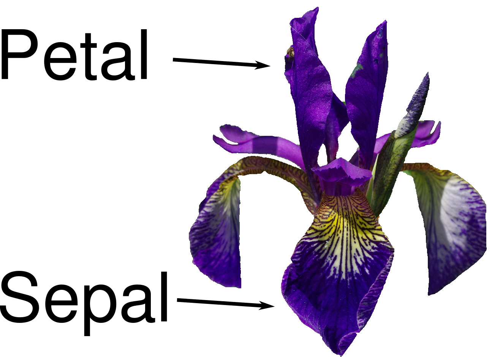

```python
from preamble import *
%matplotlib inline
```

## Introduction
### Why Machine Learning?
#### Problems Machine Learning Can Solve

#### Knowing Your Task and Knowing Your Data

### Why Python?

### scikit-learn
#### Installing scikit-learn

### Essential Libraries and Tools

#### Jupyter Notebook

#### NumPy

```python
import numpy as np

x = np.array([[1, 2, 3], [4, 5, 6]])
print("x:\n{}".format(x))
```

#### SciPy

```python
from scipy import sparse

# Create a 2D NumPy array with a diagonal of ones, and zeros everywhere else
eye = np.eye(4)
print("NumPy array:\n", eye)
```

```python
# Convert the NumPy array to a SciPy sparse matrix in CSR format
# Only the nonzero entries are stored
sparse_matrix = sparse.csr_matrix(eye)
print("\nSciPy sparse CSR matrix:\n", sparse_matrix)
```

```python
data = np.ones(4)
row_indices = np.arange(4)
col_indices = np.arange(4)
eye_coo = sparse.coo_matrix((data, (row_indices, col_indices)))
print("COO representation:\n", eye_coo)
```

#### matplotlib

```python
%matplotlib inline
import matplotlib.pyplot as plt

# Generate a sequence of numbers from -10 to 10 with 100 steps in between
x = np.linspace(-10, 10, 100)
# Create a second array using sine
y = np.sin(x)
# The plot function makes a line chart of one array against another
plt.plot(x, y, marker="x")
```

#### pandas

```python
import pandas as pd

# create a simple dataset of people
data = {'Name': ["John", "Anna", "Peter", "Linda"],
        'Location' : ["New York", "Paris", "Berlin", "London"],
        'Age' : [24, 13, 53, 33]
       }

data_pandas = pd.DataFrame(data)
# IPython.display allows "pretty printing" of dataframes
# in the Jupyter notebook
display(data_pandas)
```

```python
# Select all rows that have an age column greater than 30
display(data_pandas[data_pandas.Age > 30])
```

#### mglearn

### Python 2 versus Python 3

### Versions Used in this Book

```python
import sys
print("Python version:", sys.version)

import pandas as pd
print("pandas version:", pd.__version__)

import matplotlib
print("matplotlib version:", matplotlib.__version__)

import numpy as np
print("NumPy version:", np.__version__)

import scipy as sp
print("SciPy version:", sp.__version__)

import IPython
print("IPython version:", IPython.__version__)

import sklearn
print("scikit-learn version:", sklearn.__version__)
```

### A First Application: Classifying Iris Species

#### Meet the Data

```python
from sklearn.datasets import load_iris
iris_dataset = load_iris()
```

```python
print("Keys of iris_dataset:\n", iris_dataset.keys())
```

```python
print(iris_dataset['DESCR'][:193] + "\n...")
```

```python
print("Target names:", iris_dataset['target_names'])
```

```python
print("Feature names:\n", iris_dataset['feature_names'])
```

```python
print("Type of data:", type(iris_dataset['data']))
```

```python
print("Shape of data:", iris_dataset['data'].shape)
```

```python
print("First five rows of data:\n", iris_dataset['data'][:5])
```

```python
print("Type of target:", type(iris_dataset['target']))
```

```python
print("Shape of target:", iris_dataset['target'].shape)
```

```python
print("Target:\n", iris_dataset['target'])
```

#### Measuring Success: Training and Testing Data

```python
from sklearn.model_selection import train_test_split
X_train, X_test, y_train, y_test = train_test_split(
    iris_dataset['data'], iris_dataset['target'], random_state=0)
```

```python
print("X_train shape:", X_train.shape)
print("y_train shape:", y_train.shape)
```

```python
print("X_test shape:", X_test.shape)
print("y_test shape:", y_test.shape)
```

#### First Things First: Look at Your Data

```python
# create dataframe from data in X_train
# label the columns using the strings in iris_dataset.feature_names
iris_dataframe = pd.DataFrame(X_train, columns=iris_dataset.feature_names)
# create a scatter matrix from the dataframe, color by y_train
pd.plotting.scatter_matrix(iris_dataframe, c=y_train, figsize=(15, 15),
                           marker='o', hist_kwds={'bins': 20}, s=60,
                           alpha=.8, cmap=mglearn.cm3)
```

#### Building Your First Model: k-Nearest Neighbors

```python
from sklearn.neighbors import KNeighborsClassifier
knn = KNeighborsClassifier(n_neighbors=1)
```

```python
knn.fit(X_train, y_train)
```

#### Making Predictions

```python
X_new = np.array([[5, 2.9, 1, 0.2]])
print("X_new.shape:", X_new.shape)
```

```python
prediction = knn.predict(X_new)
print("Prediction:", prediction)
print("Predicted target name:",
       iris_dataset['target_names'][prediction])
```

#### Evaluating the Model

```python
y_pred = knn.predict(X_test)
print("Test set predictions:\n", y_pred)
```

```python
print("Test set score: {:.2f}".format(np.mean(y_pred == y_test)))
```

```python
print("Test set score: {:.2f}".format(knn.score(X_test, y_test)))
```

### Summary and Outlook

```python
X_train, X_test, y_train, y_test = train_test_split(
    iris_dataset['data'], iris_dataset['target'], random_state=0)

knn = KNeighborsClassifier(n_neighbors=1)
knn.fit(X_train, y_train)

print("Test set score: {:.2f}".format(knn.score(X_test, y_test)))
```
