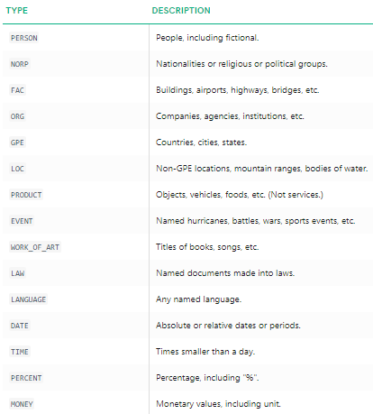
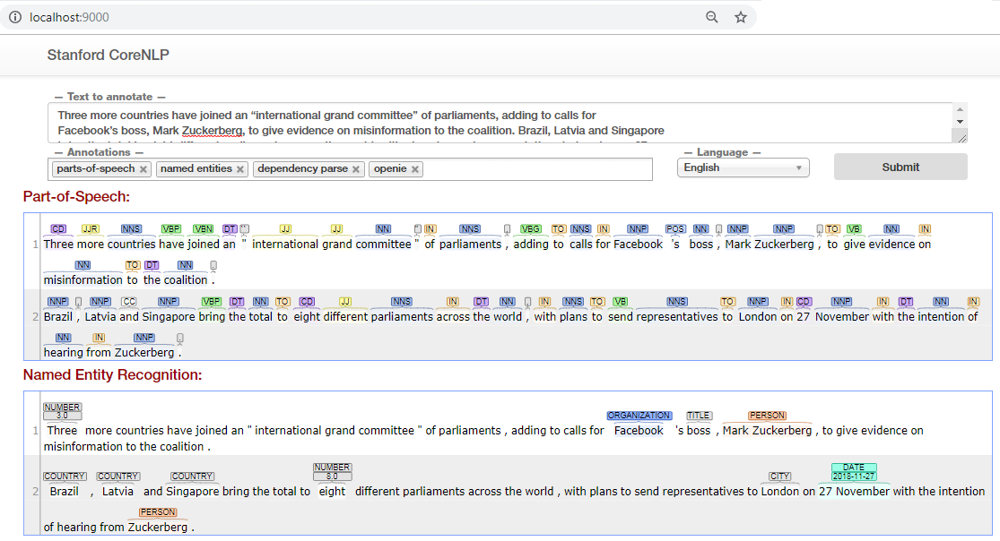

# Named Entity Recognition

In any text document, there are particular terms that represent specific entities that are more informative and have a unique context. These entities are known as named entities , which more specifically refer to terms that represent real-world objects like people, places, organizations, and so on, which are often denoted by proper names.

__Named entity recognition (NER)__ , also known as entity chunking/extraction , is a popular technique used in information extraction to identify and segment the named entities and classify or categorize them under various predefined classes.

There are out of the box NER taggers available through popular libraries like __`nltk`__ and __`spacy`__. Each library follows a different approach to solve the problem.

# NER with SpaCy

```python
text = """Three more countries have joined an “international grand committee” of parliaments, adding to calls for
Facebook’s boss, Mark Zuckerberg, to give evidence on misinformation to the coalition. Brazil, Latvia and Singapore
bring the total to eight different parliaments across the world, with plans to send representatives to London on 27
November with the intention of hearing from Zuckerberg. Since the Cambridge Analytica scandal broke, the Facebook chief
has only appeared in front of two legislatures: the American Senate and House of Representatives, and the European parliament.
Facebook has consistently rebuffed attempts from others, including the UK and Canadian parliaments, to hear from Zuckerberg.
He added that an article in the New York Times on Thursday, in which the paper alleged a pattern of behaviour from Facebook
to “delay, deny and deflect” negative news stories, “raises further questions about how recent data breaches were allegedly
dealt with within Facebook.”
"""
print(text)
```

```python
import re

text = re.sub(r'\n', '', text)
text
```

```python
import spacy

nlp = spacy.load('en')
text_nlp = nlp(text)
```

```python
# print named entities in article
ner_tagged = [(word.text, word.ent_type_) for word in text_nlp]
print(ner_tagged)
```

```python
from spacy import displacy

# visualize named entities
displacy.render(text_nlp, style='ent', jupyter=True)
```

Spacy offers fast NER tagger based on a number of techniques. The exact algorithm hasn't been talked about in much detail but the documentation marks it as <font color=blue> "The exact algorithm is a pastiche of well-known methods, and is not currently described in any single publication " </font>

The entities identified by spacy NER tagger are as shown in the following table \(details here: [spacy_documentation](https://spacy.io/api/annotation#named-entities)\)



```python
named_entities = []
temp_entity_name = ''
temp_named_entity = None
for term, tag in ner_tagged:
    if tag:
        temp_entity_name = ' '.join([temp_entity_name, term]).strip()
        temp_named_entity = (temp_entity_name, tag)
    else:
        if temp_named_entity:
            named_entities.append(temp_named_entity)
            temp_entity_name = ''
            temp_named_entity = None
```

```python
print(named_entities)
```

```python
from collections import Counter
c = Counter([item[1] for item in named_entities])
c.most_common()
```

# NER with Stanford NLP

Stanford’s Named Entity Recognizer is based on an implementation of linear chain __Conditional Random Field (CRF)__ sequence models.

__Prerequisites:__ Download the official Stanford NER Tagger from [here](http://nlp.stanford.edu/software/stanford-ner-2014-08-27.zip), which seems to work quite well. You can try out a later version by going to [this website](https://nlp.stanford.edu/software/CRF-NER.shtml#Download)

This model is only trained on instances of _PERSON, ORGANIZATION and LOCATION_ types. The model is exposed through ```nltk``` wrappers.

```python
import os
from nltk.tag import StanfordNERTagger

JAVA_PATH = r'C:\Program Files\Java\jre1.8.0_192\bin\java.exe'
os.environ['JAVAHOME'] = JAVA_PATH

STANFORD_CLASSIFIER_PATH = 'E:/stanford/stanford-ner-2014-08-27/classifiers/english.all.3class.distsim.crf.ser.gz'
STANFORD_NER_JAR_PATH = 'E:/stanford/stanford-ner-2014-08-27/stanford-ner.jar'

sn = StanfordNERTagger(STANFORD_CLASSIFIER_PATH,
                       path_to_jar=STANFORD_NER_JAR_PATH)
sn
```

```python
text_enc = text.encode('ascii', errors='ignore').decode('utf-8')
ner_tagged = sn.tag(text_enc.split())
print(ner_tagged)
```

```python
named_entities = []
temp_entity_name = ''
temp_named_entity = None
for term, tag in ner_tagged:
    if tag != 'O':
        temp_entity_name = ' '.join([temp_entity_name, term]).strip()
        temp_named_entity = (temp_entity_name, tag)
    else:
        if temp_named_entity:
            named_entities.append(temp_named_entity)
            temp_entity_name = ''
            temp_named_entity = None
```

```python
print(named_entities)
```

```python
c = Counter([item[1] for item in named_entities])
c.most_common()
```

# NER with Stanford CoreNLP

NLTK is slowly deprecating the old Stanford Parsers in favor of the more active Stanford Core NLP Project. It might even get removed after `nltk` version `3.4` so best to stay updated.

Details: https://github.com/nltk/nltk/issues/1839

Step by Step Tutorial here: https://github.com/nltk/nltk/wiki/Stanford-CoreNLP-API-in-NLTK

Sadly a lot of things have changed in the process so we need to do some extra effort to make it work!

Get CoreNLP from [here](https://stanfordnlp.github.io/CoreNLP/)

After you download, go to the folder and spin up a terminal and start the Core NLP Server locally

```
E:\> java -mx4g -cp "*" edu.stanford.nlp.pipeline.StanfordCoreNLPServer -preload tokenize,ssplit,pos,lemma,ner,parse,depparse -status_port 9000 -port 9000 -timeout 15000
```

If it runs successfully you should see the following messages on the terminal

```
E:\stanford\stanford-corenlp-full-2018-02-27>java -mx4g -cp "*" edu.stanford.nlp.pipeline.StanfordCoreNLPServer -preload tokenize,ssplit,pos,lemma,ner,parse,depparse -status_port 9000 -port 9000 -timeout 15000
[main] INFO CoreNLP - --- StanfordCoreNLPServer#main() called ---
[main] INFO CoreNLP - setting default constituency parser
[main] INFO CoreNLP - warning: cannot find edu/stanford/nlp/models/srparser/englishSR.ser.gz
[main] INFO CoreNLP - using: edu/stanford/nlp/models/lexparser/englishPCFG.ser.gz instead
[main] INFO CoreNLP - to use shift reduce parser download English models jar from:
[main] INFO CoreNLP - http://stanfordnlp.github.io/CoreNLP/download.html
[main] INFO CoreNLP -     Threads: 4
[main] INFO edu.stanford.nlp.pipeline.StanfordCoreNLP - Adding annotator tokenize
[main] INFO edu.stanford.nlp.pipeline.TokenizerAnnotator - No tokenizer type provided. Defaulting to PTBTokenizer.
[main] INFO edu.stanford.nlp.pipeline.StanfordCoreNLP - Adding annotator ssplit
[main] INFO edu.stanford.nlp.pipeline.StanfordCoreNLP - Adding annotator pos
[main] INFO edu.stanford.nlp.tagger.maxent.MaxentTagger - Loading POS tagger from edu/stanford/nlp/models/pos-tagger/english-left3words/english-left3words-distsim.tagger ... done [1.4 sec].
[main] INFO edu.stanford.nlp.pipeline.StanfordCoreNLP - Adding annotator lemma
[main] INFO edu.stanford.nlp.pipeline.StanfordCoreNLP - Adding annotator ner
[main] INFO edu.stanford.nlp.ie.AbstractSequenceClassifier - Loading classifier from edu/stanford/nlp/models/ner/english.all.3class.distsim.crf.ser.gz ... done [1.9 sec].
[main] INFO edu.stanford.nlp.ie.AbstractSequenceClassifier - Loading classifier from edu/stanford/nlp/models/ner/english.muc.7class.distsim.crf.ser.gz ... done [2.0 sec].
[main] INFO edu.stanford.nlp.ie.AbstractSequenceClassifier - Loading classifier from edu/stanford/nlp/models/ner/english.conll.4class.distsim.crf.ser.gz ... done [0.8 sec].
[main] INFO edu.stanford.nlp.time.JollyDayHolidays - Initializing JollyDayHoliday for SUTime from classpath edu/stanford/nlp/models/sutime/jollyday/Holidays_sutime.xml as sutime.binder.1.
[main] INFO edu.stanford.nlp.time.TimeExpressionExtractorImpl - Using following SUTime rules: edu/stanford/nlp/models/sutime/defs.sutime.txt,edu/stanford/nlp/models/sutime/english.sutime.txt,edu/stanford/nlp/models/sutime/english.holidays.sutime.txt
[main] INFO edu.stanford.nlp.pipeline.TokensRegexNERAnnotator - TokensRegexNERAnnotator ner.fine.regexner: Read 580641 unique entries out of 581790 from edu/stanford/nlp/models/kbp/regexner_caseless.tab, 0 TokensRegex patterns.
[main] INFO edu.stanford.nlp.pipeline.TokensRegexNERAnnotator - TokensRegexNERAnnotator ner.fine.regexner: Read 4857 unique entries out of 4868 from edu/stanford/nlp/models/kbp/regexner_cased.tab, 0 TokensRegex patterns.
[main] INFO edu.stanford.nlp.pipeline.TokensRegexNERAnnotator - TokensRegexNERAnnotator ner.fine.regexner: Read 585498 unique entries from 2 files
[main] INFO edu.stanford.nlp.pipeline.StanfordCoreNLP - Adding annotator parse
[main] INFO edu.stanford.nlp.parser.common.ParserGrammar - Loading parser from serialized file edu/stanford/nlp/models/lexparser/englishPCFG.ser.gz ... done [4.6 sec].
[main] INFO edu.stanford.nlp.pipeline.StanfordCoreNLP - Adding annotator depparse
[main] INFO edu.stanford.nlp.parser.nndep.DependencyParser - Loading depparse model: edu/stanford/nlp/models/parser/nndep/english_UD.gz ...
[main] INFO edu.stanford.nlp.parser.nndep.Classifier - PreComputed 99996, Elapsed Time: 22.43 (s)
[main] INFO edu.stanford.nlp.parser.nndep.DependencyParser - Initializing dependency parser ... done [24.4 sec].
[main] INFO CoreNLP - Starting server...
[main] INFO CoreNLP - StanfordCoreNLPServer listening at /0:0:0:0:0:0:0:0:9000
```



```python
from nltk.parse import CoreNLPParser

ner_tagger = CoreNLPParser(url='http://localhost:9000', tagtype='ner')
ner_tagger
```

```python
import nltk

tags = list(ner_tagger.raw_tag_sents(nltk.sent_tokenize(text)))
tags = [sublist[0] for sublist in tags]
tags = [word_tag for sublist in tags for word_tag in sublist]
print(tags)
```

```python
named_entities = []
temp_entity_name = ''
temp_named_entity = None
for term, tag in tags:
    if tag != 'O':
        temp_entity_name = ' '.join([temp_entity_name, term]).strip()
        temp_named_entity = (temp_entity_name, tag)
    else:
        if temp_named_entity:
            named_entities.append(temp_named_entity)
            temp_entity_name = ''
            temp_named_entity = None

print(named_entities)
```

```python
c = Counter([item[1] for item in named_entities])
c.most_common()
```
