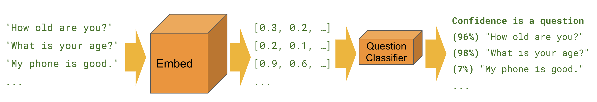

# Sentiment Analysis - Text Classification with Universal Embeddings

Textual data in spite of being highly unstructured, can be classified into two major types of documents.
- __Factual documents__ which typically depict some form of statements or facts with no specific feelings or emotion attached to them. These are also known as objective documents.
- __Subjective documents__ on the other hand have text which expresses feelings, mood, emotions and opinion.

Sentiment Analysis is also popularly known as opinion analysis or opinion mining. The key idea is to use techniques from text analytics, NLP, machine learning and linguistics to extract important information or data points from unstructured text. This in turn can help us derive the sentiment from text data


Here we will be looking at building supervised sentiment analysis classification models thanks to the advantage of labeled data! The dataset we will be working with is the IMDB Large Movie Review Dataset having 50000 reviews classified into positive and negative sentiment. I have provided a compressed version of the dataset in this repository itself for your benefit!

Do remember that the focus here is not sentiment analysis but text classification by leveraging universal sentence embeddings.



We will leverage the following sentence encoders here for demonstration from [TensorFlow Hub](https://tfhub.dev/):

- [__Neural-Net Language Model (nnlm-en-dim128)__](https://tfhub.dev/google/nnlm-en-dim128/1)
- [__Universal Sentence Encoder (universal-sentence-encoder)__](https://tfhub.dev/google/universal-sentence-encoder/2)


_Developed by [Dipanjan (DJ) Sarkar](https://www.linkedin.com/in/dipanzan/)_

**Staleness note (TF 1.x → 2.x, #36):** This notebook uses `tf.estimator`, `hub.text_embedding_column`, and `tf.Session` — TF1-era APIs. Updated to use `tensorflow.compat.v1` shim for TF 2.x. Note: `hub.text_embedding_column` is not available in modern TensorFlow Hub; to run on TF2, replace `tf.estimator.DNNClassifier` with a Keras model using `hub.KerasLayer`. The compat.v1 approach allows the notebook to load but TF Hub module URLs may also need updating.

# Install Tensorflow Hub

```python
!pip install tensorflow-hub
```

# Load up Dependencies

```python
import tensorflow.compat.v1 as tf
tf.disable_v2_behavior()
import tensorflow_hub as hub
import numpy as np
import pandas as pd
# NOTE (staleness #36): This notebook was authored against TF 1.x.
# The training/model cells already use tf.keras and run on TF 2.x.
# Cell 43 (confusion matrix) still uses tf.Session; fixed below with tf.compat.v1.
```

# Check if GPU is available for use!

```python
tf.test.is_gpu_available()
```

```python
tf.test.gpu_device_name()
```

# Load and View Dataset

```python
dataset = pd.read_csv('movie_reviews.csv.bz2', compression='bz2')
dataset.info()
```

```python
dataset['sentiment'] = [1 if sentiment == 'positive' else 0 for sentiment in dataset['sentiment'].values]
dataset.head()
```

# Build train, validation and test datasets

```python
reviews = dataset['review'].values
sentiments = dataset['sentiment'].values

train_reviews = reviews[:30000]
train_sentiments = sentiments[:30000]

val_reviews = reviews[30000:35000]
val_sentiments = sentiments[30000:35000]

test_reviews = reviews[35000:]
test_sentiments = sentiments[35000:]
train_reviews.shape, val_reviews.shape, test_reviews.shape
```

# Basic Text Wrangling

```python
!pip install contractions
!pip install beautifulsoup4
```

```python
import contractions
from bs4 import BeautifulSoup
import unicodedata
import re


def strip_html_tags(text):
    soup = BeautifulSoup(text, "html.parser")
    [s.extract() for s in soup(['iframe', 'script'])]
    stripped_text = soup.get_text()
    stripped_text = re.sub(r'[\r|\n|\r\n]+', '\n', stripped_text)
    return stripped_text


def remove_accented_chars(text):
    text = unicodedata.normalize('NFKD', text).encode('ascii', 'ignore').decode('utf-8', 'ignore')
    return text


def expand_contractions(text):
    return contractions.fix(text)


def remove_special_characters(text, remove_digits=False):
    pattern = r'[^a-zA-Z0-9\s]' if not remove_digits else r'[^a-zA-Z\s]'
    text = re.sub(pattern, '', text)
    return text


def pre_process_document(document):

    # strip HTML
    document = strip_html_tags(document)

    # lower case
    document = document.lower()

    # remove extra newlines (often might be present in really noisy text)
    document = document.translate(document.maketrans("\n\t\r", "   "))

    # remove accented characters
    document = remove_accented_chars(document)

    # expand contractions
    document = expand_contractions(document)

    # remove special characters and\or digits
    # insert spaces between special characters to isolate them
    special_char_pattern = re.compile(r'([{.(-)!}])')
    document = special_char_pattern.sub(" \\1 ", document)
    document = remove_special_characters(document, remove_digits=True)

    # remove extra whitespace
    document = re.sub(' +', ' ', document)
    document = document.strip()

    return document


pre_process_corpus = np.vectorize(pre_process_document)
```

```python
train_reviews = pre_process_corpus(train_reviews)
val_reviews = pre_process_corpus(val_reviews)
test_reviews = pre_process_corpus(test_reviews)
```

# Build Data Ingestion Functions

```python
# Training input on the whole training set with no limit on training epochs.
train_input_fn = tf.estimator.inputs.numpy_input_fn(
    {'sentence': train_reviews}, train_sentiments,
    batch_size=256, num_epochs=None, shuffle=True)
```

```python
# Prediction on the whole training set.
predict_train_input_fn = tf.estimator.inputs.numpy_input_fn(
    {'sentence': train_reviews}, train_sentiments, shuffle=False)
```

```python
# Prediction on the whole validation set.
predict_val_input_fn = tf.estimator.inputs.numpy_input_fn(
    {'sentence': val_reviews}, val_sentiments, shuffle=False)
```

```python
# Prediction on the test set.
predict_test_input_fn = tf.estimator.inputs.numpy_input_fn(
    {'sentence': test_reviews}, test_sentiments, shuffle=False)
```

# Build Deep Learning Model with Universal Sentence Encoder

```python
embedding_feature = hub.text_embedding_column(
    key='sentence',
    module_spec="https://tfhub.dev/google/universal-sentence-encoder/2",
    trainable=False)
```

```python
dnn = tf.estimator.DNNClassifier(
          hidden_units=[512, 128],
          feature_columns=[embedding_feature],
          n_classes=2,
          activation_fn=tf.nn.relu,
          dropout=0.1,
          optimizer=tf.train.AdagradOptimizer(learning_rate=0.005))
```

### Train for approx 12 epochs

```python
256*1500 / 30000
```

# Model Training

```python
tf.logging.set_verbosity(tf.logging.ERROR)
import time

TOTAL_STEPS = 1500
STEP_SIZE = 100
for step in range(0, TOTAL_STEPS+1, STEP_SIZE):
    print()
    print('-'*100)
    print('Training for step =', step)
    start_time = time.time()
    dnn.train(input_fn=train_input_fn, steps=STEP_SIZE)
    elapsed_time = time.time() - start_time
    print('Train Time (s):', elapsed_time)
    print('Eval Metrics (Train):', dnn.evaluate(input_fn=predict_train_input_fn))
    print('Eval Metrics (Validation):', dnn.evaluate(input_fn=predict_val_input_fn))
```

# Model Evaluation

```python
dnn.evaluate(input_fn=predict_train_input_fn)
```

```python
dnn.evaluate(input_fn=predict_test_input_fn)
```

# Build a Generic Model Trainer on any Input Sentence Encoder

```python
import time

TOTAL_STEPS = 1500
STEP_SIZE = 500

my_checkpointing_config = tf.estimator.RunConfig(
    keep_checkpoint_max = 2,       # Retain the 2 most recent checkpoints.
)

def train_and_evaluate_with_sentence_encoder(hub_module, train_module=False, path=''):
    embedding_feature = hub.text_embedding_column(
        key='sentence', module_spec=hub_module, trainable=train_module)

    print()
    print('='*100)
    print('Training with', hub_module)
    print('Trainable is:', train_module)
    print('='*100)

    dnn = tf.estimator.DNNClassifier(
            hidden_units=[512, 128],
            feature_columns=[embedding_feature],
            n_classes=2,
            activation_fn=tf.nn.relu,
            dropout=0.1,
            optimizer=tf.train.AdagradOptimizer(learning_rate=0.005),
            model_dir=path,
            config=my_checkpointing_config)

    for step in range(0, TOTAL_STEPS+1, STEP_SIZE):
        print('-'*100)
        print('Training for step =', step)
        start_time = time.time()
        dnn.train(input_fn=train_input_fn, steps=STEP_SIZE)
        elapsed_time = time.time() - start_time
        print('Train Time (s):', elapsed_time)
        print('Eval Metrics (Train):', dnn.evaluate(input_fn=predict_train_input_fn))
        print('Eval Metrics (Validation):', dnn.evaluate(input_fn=predict_val_input_fn))

    train_eval_result = dnn.evaluate(input_fn=predict_train_input_fn)
    test_eval_result = dnn.evaluate(input_fn=predict_test_input_fn)

    return {
      "Model Dir": dnn.model_dir,
      "Training Accuracy": train_eval_result["accuracy"],
      "Test Accuracy": test_eval_result["accuracy"],
      "Training AUC": train_eval_result["auc"],
      "Test AUC": test_eval_result["auc"],
      "Training Precision": train_eval_result["precision"],
      "Test Precision": test_eval_result["precision"],
      "Training Recall": train_eval_result["recall"],
      "Test Recall": test_eval_result["recall"]
    }
```

# Train Deep Learning Models on difference Sentence Encoders
- NNLM - pre-trained and fine-tuning
- USE - pre-trained and fine-tuning

```python
tf.logging.set_verbosity(tf.logging.ERROR)

results = {}

results["nnlm-en-dim128"] = train_and_evaluate_with_sentence_encoder(
    "https://tfhub.dev/google/nnlm-en-dim128/1", path='/storage/models/nnlm-en-dim128_f/')

results["nnlm-en-dim128-with-training"] = train_and_evaluate_with_sentence_encoder(
    "https://tfhub.dev/google/nnlm-en-dim128/1", train_module=True, path='/storage/models/nnlm-en-dim128_t/')

results["use-512"] = train_and_evaluate_with_sentence_encoder(
    "https://tfhub.dev/google/universal-sentence-encoder/2", path='/storage/models/use-512_f/')

results["use-512-with-training"] = train_and_evaluate_with_sentence_encoder(
    "https://tfhub.dev/google/universal-sentence-encoder/2", train_module=True, path='/storage/models/use-512_t/')
```

# Model Evaluations

```python
results_df = pd.DataFrame.from_dict(results, orient="index")
results_df
```

```python
best_model_dir = results_df[results_df['Test Accuracy'] == results_df['Test Accuracy'].max()]['Model Dir'].values[0]
best_model_dir
```

```python
embedding_feature = hub.text_embedding_column(
        key='sentence', module_spec="https://tfhub.dev/google/universal-sentence-encoder/2", trainable=True)

dnn = tf.estimator.DNNClassifier(
            hidden_units=[512, 128],
            feature_columns=[embedding_feature],
            n_classes=2,
            activation_fn=tf.nn.relu,
            dropout=0.1,
            optimizer=tf.train.AdagradOptimizer(learning_rate=0.005),
            model_dir=best_model_dir)
dnn
```

```python
def get_predictions(estimator, input_fn):
    return [x["class_ids"][0] for x in estimator.predict(input_fn=input_fn)]
```

```python
predictions = get_predictions(estimator=dnn, input_fn=predict_test_input_fn)
predictions[:10]
```

```python
!pip install seaborn
```

```python
import seaborn as sns
import matplotlib.pyplot as plt

%matplotlib inline

# tf.confusion_matrix / tf.Session removed in TF 2.x; use tf.math.confusion_matrix (eager)
cm = tf.math.confusion_matrix(test_sentiments, predictions).numpy()

LABELS = ['negative', 'positive']
sns.heatmap(cm, annot=True, xticklabels=LABELS, yticklabels=LABELS, fmt='g')
xl = plt.xlabel("Predicted")
yl = plt.ylabel("Actuals")
```

```python
from sklearn.metrics import classification_report

print(classification_report(y_true=test_sentiments, y_pred=predictions, target_names=LABELS))
```
