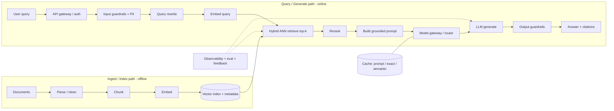

# RAG / Document Q&A system design template

The phase skeleton the walkthroughs follow. Use it as the board layout for a new problem.

## 1. Frame the problem (5-10 min)

- Identify users and use cases: who queries, over what corpus, what is a 'good' answer.
- Pin down scale: corpus size (docs/chunks), QPS, growth, freshness needs (batch vs real-time updates).
- Set the quality bar and non-functional targets: accuracy/grounding expectation, p95 latency, cost/query budget.
- Surface guardrails up front: privacy/PII, access control, prompt injection, what the system must NOT do.
- State assumptions out loud and confirm them before designing. Don't jump to a solution first (the #1 mistake).

## 2. High-level architecture (10-15 min)

- Draw the two paths explicitly. INGEST/INDEX path (offline): load -> parse -> chunk -> embed -> upsert to vector index (+ metadata store).
- QUERY/GENERATE path (online): query -> (optional) rewrite -> embed -> ANN retrieve top-k -> rerank -> assemble grounded prompt -> LLM generate -> answer WITH citations.
- Name the cross-cutting layers: API gateway/auth, model gateway/router, cache, guardrails (input+output), observability/eval.
- Narrate the data flow as a guided tour ('prompt in -> context build -> model call -> post-process -> logs'), not a parts list.

## 3. Deep-dive components (20-30 min)

- Chunking & embeddings: chunk size/overlap, semantic vs fixed-window chunking, embedding model choice, store metadata for filtering/citations.
- Retrieval: hybrid search = sparse/lexical (BM25) for exact terms + dense/vector for semantics; ANN index choice (HNSW in-RAM vs IVF/IVF-PQ at scale); metadata filters + ACL enforcement at query time.
- Reranking: retrieve many (high recall) then cross-encoder rerank down to a few (protect the context window); retrieval recall up, tokens-to-LLM down.
- Grounding & citations: generate strictly from retrieved context, attach inline citations/provenance; handle empty/low-confidence retrieval (abstain, ask to clarify, or fall back).
- Evaluation: offline golden sets + adversarial/red-team; online A/B + feedback signals; RAG-specific metrics (context relevance/precision, groundedness/faithfulness, answer quality) with LLM-as-judge (and its limits).
- Guardrails: input (PII/jailbreak detection, ACL/scope checks) and output (toxicity, hallucination/faithfulness check, sensitive-data leak, format).
- Serving concerns: model gateway (multi-vendor, fallback, token/cost accounting), streaming responses, prompt/token budgeting.

## 4. Trade-offs, failure modes, scale (10-15 min)

- Retrieval recall vs latency vs cost: bigger k / reranking / larger model improve quality but cost tokens and time.
- Caching for cost+latency: prompt cache (shared prefixes), exact cache (identical requests), semantic cache (similar queries — flag its false-match risk).
- Model tiering / routing: cheap small model for easy queries, premium model for hard ones; classifier decides.
- Freshness vs cost: how index updates propagate; stale-index detection; batch vs streaming ingestion.
- Failure modes to name AND detect: hallucination on empty retrieval, stale/missing docs, cost blowup, prompt injection, context overflow; describe graceful degradation.

## 5. Conclude (last min)

- Summarize the design, restate the biggest risks, and outline the next iteration (what you'd measure and improve first).

## Key patterns

- Grounding over trust: never treat the LLM as the source of truth. Ground every answer in retrieval and cite sources. [interviewnode, slack, bytebytego-perplexity]
- Stateless RAG: pass all needed context per request so the model retains nothing. That's a privacy win and a product win (answers grounded in your corpus, not the open web). [slack]
- Least privilege + ACLs at query time: retrieve only what the requesting user may see. Propagate the user's own permissions, and gate write actions behind human approval. [slack, doctolib]
- Two-stage retrieval: cheap recall-oriented retrieval, then expensive precision reranking. [pinecone]
- Model gateway/router: one interface over many providers with fallback, PII redaction, cost/latency accounting. [chip-huyen, uber]
- Multi-layer caching + model tiering to bend the cost/latency curve without more GPUs. [chip-huyen, interviewnode]
- Evaluation isn't optional: golden sets, LLM-as-judge, online feedback loop. Skipping it reads as not production-ready. [igotanoffer, interviewnode]

## Skeleton diagram

## Sources

- [IGotAnOffer — Generative AI System Design Interview](https://igotanoffer.com/en/advice/generative-ai-system-design-interview)
- [Chip Huyen — Building a Generative AI Platform](https://huyenchip.com/2024/07/25/genai-platform.html)
- [InterviewNode — GenAI System Design Interview Patterns](https://www.interviewnode.com/post/generative-ai-system-design-interview-patterns-you-should-know)
- [ByteByteGo — How Perplexity Built an AI Google](https://blog.bytebytego.com/p/how-perplexity-built-an-ai-google)
- [Slack Engineering — How We Built Slack AI to be Secure and Private](https://slack.engineering/how-we-built-slack-ai-to-be-secure-and-private/)
- [Uber — GenAI Gateway](https://www.uber.com/blog/genai-gateway/)
- [Doctolib — Building an Agentic AI System for Healthcare Support](https://medium.com/doctolib/building-an-agentic-ai-system-for-healthcare-support-a-journey-into-practical-ai-implementation-0afd28d716e6)
- [Pinecone — Rerankers and Two-Stage Retrieval](https://www.pinecone.io/learn/series/rag/rerankers/)
- [BigDataBoutique / Milvus — HNSW vs IVF vector index tradeoffs](https://bigdataboutique.com/blog/hnsw-vs-ivfflat-how-to-choose-the-right-vector-index)
